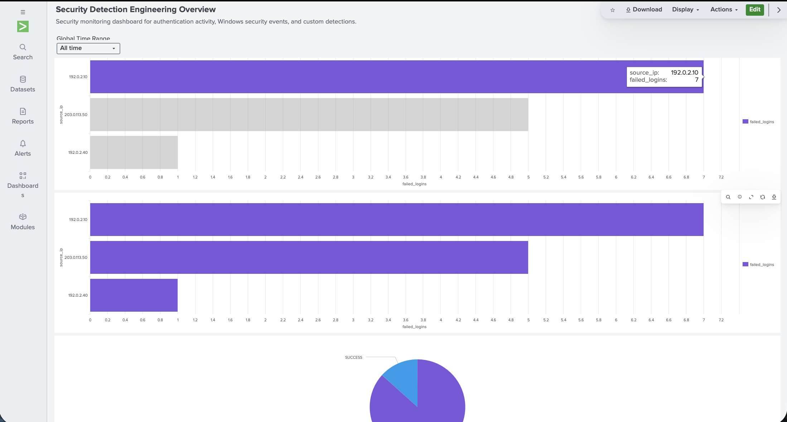

# Splunk Detection Engineering Lab

## Project Overview

This project demonstrates the development, testing, and visualization of custom security detections using Splunk Cloud Platform.

The lab uses synthetic authentication logs and Windows Security Events to simulate suspicious activity and demonstrate practical security detection engineering techniques.

## Technologies Used

- Splunk Cloud Platform
- Splunk Search Processing Language (SPL)
- Windows Security Event logs
- CSV and JSON log ingestion
- Splunk Dashboard Studio
- Scheduled Splunk Alerts

## Security Detections Developed

### 1. Brute-Force Authentication Detection
Identifies five failed login attempts from the same source IP within a ten-minute window.

## 2. Password-Spraying Detection
Identifies five or more failed authentication attempts targeting at least five distinct user accounts wihtin ten minutes.

## 3. Suspicious Windows Privilege Changes
Correlates Windows Event IDs 4720 and 4732 to identify newly created user accounts added to the local Administrators group within ten minutes.

## Validation

Detection logic was tested using synthetic security events, positive and negative test scenarios, and correlation tuning.

A Splunk security dashboard was developed to visualize authentication activity, Windows Security Events, and detection results.

A scheduled security alert was configured. Acutal scheduled-alert trigerring remains pending verification.

## Detection Results & Evidence

## Brute-Force Authentication Detection

Identified two source IP addresses generating five failed authentication attempts within ten minutes.

- 192.0.2.10 - 5 failures within 239 seconds.
- 203.0.113.50 - 5 failures within 240 seconds.

**Detection Query:** [View SPL](detections/brute_force_detection.spl)

**Evidence:** [View Detection Results](screenshots/brute_force_detection_results.png)

### Password-Spraying Detection

Identified a source IP attempting authentication against five distinct usernames within ten minutes.

- Source IP: 198.51.100.44
- Failed Logins: 5
- Unique Users: 5

**Detection Query:** [View SPL](detections/password_spraying_detection.spl)

**Evidence:** [View Detection Results](screenshots/password_spraying_detection_results.png)

### Windows Privilege-Change Detection

Correlated Windows Event IDs 4720 and 4732 to identify an account added to the local Administrators group shortly after creation.

- Actor: lab-admin
- Target Account: newadmin
- Group: Administrators
- Time Between Events: 60 seconds

**Detection Query:** [View SPL](detections/windows_privilege_change_detection.spl)

## Security Monitoring Dashboard

Built a Splunk Dashboard Studio dashboard containing six visualizations covering authentication activity, Windows Security Events, and custom detection results.

## Detection Testing Documentation

Positive testing, negative testing, correlation improvements, and known limitations are documented separately.

[View Detection Validation Report](testing/detection_validation.md)